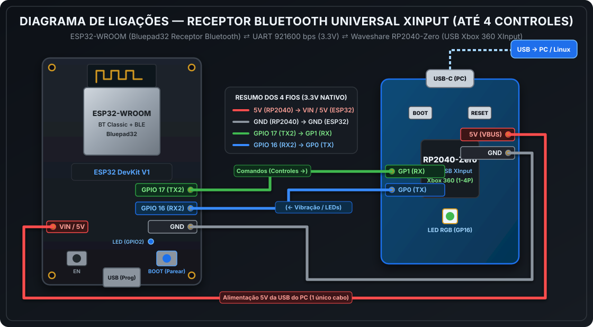

# Receptor Bluetooth Universal XInput (ESP32-WROOM + RP2040-Zero)

Transforma um **ESP32-WROOM** + **Waveshare RP2040-Zero** em um receptor USB Bluetooth universal para até **4 controles sem fio simultâneos**, reconhecidos nativamente no **Windows** e no **Linux** como um **Receptor Sem Fio Xbox 360 (`045E:0719`)** a **1000 Hz** com suporte a **vibração (Rumble)** e **LEDs de jogador**.

Compatível com controles **Bluetooth Clássico (BR/EDR)** e **BLE**: PS4, PS5, Xbox Wireless, Nintendo Switch Pro, Joy-Cons, 8BitDo, GameSir e controles Bluetooth genéricos.

---

## Esquema de Ligação (4 Fios)

As duas placas operam em **3.3V** e são interligadas diretamente por **4 fios**. No uso diário, conecte **apenas o RP2040-Zero na USB do PC** (ele alimenta o ESP32 pelo pino `5V`).



| ESP32-WROOM | RP2040-Zero | Função |
| :--- | :--- | :--- |
| **`VIN` / `5V`** | **`5V`** | Alimentação 5V vinda da USB do RP2040-Zero |
| **`GND`** | **`GND`** | Terra comum |
| **`GPIO 17` (TX2)** | **`GP1` (RX)** | Comandos dos controles: ESP32 → RP2040 (`921600 bps`) |
| **`GPIO 16` (RX2)** | **`GP0` (TX)** | Vibração (*Rumble*) e LEDs: RP2040 → ESP32 (`921600 bps`) |

---

## Como Compilar e Gravar (Modo 100% Portátil)

Não é necessário instalar Arduino IDE ou bibliotecas no Windows. Os scripts `.bat` na raiz baixam e configuram tudo localmente na pasta `tools/`:

1. **`setup_tools.bat`** — Baixa o `arduino-cli`, os cores do **ESP32 (Bluepad32)** e **RP2040**, aplica o patch de conexões simultâneas (`maxACL=7`) e instala as bibliotecas necessárias.
2. **`flash_esp32.bat`** — Compila e grava o firmware receptor Bluetooth no **ESP32-WROOM** via porta COM.
3. **`flash_rp2040.bat`** — Compila e grava o firmware USB XInput no **RP2040-Zero** (segure `BOOT` ao conectar o RP2040-Zero na USB para abrir a unidade `RPI-RP2`).
4. **`compile_all.bat`** — Apenas compila ambos os firmwares em `build/esp32/` e `build/rp2040/`.

---

## Como Usar e Parear Controles

- **Ao ligar:** O receptor inicia com o pareamento **fechado** (controles já pareados reconectam automaticamente ao serem ligados).
- **Parear um controle novo (1º, 2º, 3º ou 4º) sem desconectar os atuais:**
  1. Dê **1 clique curto no botão `BOOT`** do ESP32-WROOM (o LED azul começará a piscar).
  2. Coloque o novo controle em modo de pareamento. Assim que conectar, o modo de pareamento fecha automaticamente.
- **Limpar todos os controles salvos:** Segure o botão **`BOOT`** do ESP32-WROOM por **3 segundos** (o LED piscará rápido).
- **Receptor Sem Fio Dinâmico (Zero Desconexões na USB):**
  - Ao conectar na USB sem nenhum controle Bluetooth ligado, **nenhum controle** aparece no `joy.cpl` (apenas o receptor).
  - Conforme o 1º, 2º, 3º ou 4º controle conecta no Bluetooth, ele aparece dinamicamente no Windows pelo protocolo nativo do **Receptor Sem Fio Xbox 360 (`045E:0719`)** — **sem desconectar ou interromper** quem já está jogando!

### Status do LED RGB (`GP16` no RP2040-Zero)
| Cor do LED | Significado |
| :--- | :--- |
| 🟡 **Amarelo piscando** | Aguardando comunicação UART com o ESP32 (verifique os 4 fios) |
| 🔵 **Azul piscando** | Modo de Pareamento **ABERTO** (procurando novo controle) |
| 🟢 **Verde fixo** | **1 controle** conectado |
| 🩵 **Ciano fixo** | **2 controles** conectados |
| 🟣 **Roxo fixo** | **3 controles** conectados |
| 🟡 **Ouro fixo** | **4 controles** conectados |
| 🔴 **Vermelho fraco** | 0 controles conectados e pareamento fechado (clique em `BOOT` para abrir) |

---

## Estrutura do Projeto

```text
├── docs/                  # Diagramas de ligação (JPG e SVG)
├── esp32_bt_receiver/     # Firmware do ESP32-WROOM (Receptor Bluetooth Bluepad32)
├── rp2040_xinput_usb/     # Firmware do RP2040-Zero (Dispositivo USB Xbox 360 XInput)
├── shared/                # Protocolo binário UART com CRC8 compartilhado entre as placas
├── setup_tools.bat        # Instalação portátil das ferramentas em tools/
├── compile_all.bat        # Compilação completa dos dois firmwares
├── flash_esp32.bat        # Gravação automática no ESP32-WROOM
├── flash_rp2040.bat       # Gravação automática no RP2040-Zero
└── monitor_esp32.bat      # Monitor serial de diagnóstico
```

---

## Créditos e Projetos de Terceiros

Este projeto só foi possível graças aos excelentes projetos open-source abaixo:

- **[Bluepad32](https://github.com/ricardoquesada/bluepad32)** por *Ricardo Quesada* — Framework de suporte a múltiplos controles Bluetooth (BR/EDR e BLE) no ESP32.
- **[BTstack](https://github.com/bluekitchen/btstack)** por *BlueKitchen GmbH* — Pilha Bluetooth dual-mode utilizada pelo Bluepad32.
- **[Arduino-Pico (RP2040 Core)](https://github.com/earlephilhower/arduino-pico)** por *Earle F. Philhower, III* — Core Arduino para o microcontrolador RP2040.
- **[TinyUSB](https://github.com/hathach/tinyusb)** & **[Adafruit TinyUSB Library](https://github.com/adafruit/Adafruit_TinyUSB_Arduino)** por *Ha Thach (hathach)* e *Adafruit Industries* — Pilha USB usada para implementar os descritores XInput (`XUSB10`).
- **[Adafruit NeoPixel](https://github.com/adafruit/Adafruit_NeoPixel)** por *Adafruit Industries* — Controle do LED RGB WS2812 integrado no RP2040-Zero.
- **[Arduino CLI](https://github.com/arduino/arduino-cli)** por *Arduino* — Compilação e gravação via linha de comando em modo portátil.
- **[ESP32-BLE-Gamepad](https://github.com/lemmingDev/ESP32-BLE-Gamepad)** por *lemmingDev* — Inspiração inicial para a arquitetura do projeto.
